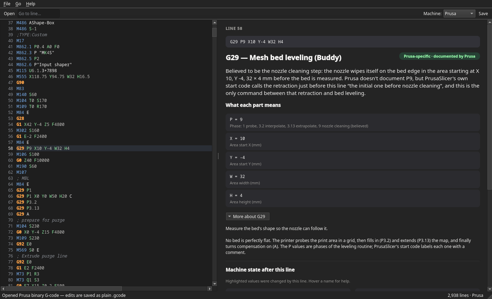

# Ventris

**Explains G-code line by line.** Open a 3D-printer or laser-cutter file and click any line: Ventris
tells you, in plain English, what that line makes the printer do — and shows what the
machine is doing at that moment (position, temperatures, fans, layer, what part of the
model is printing).



- **For beginners first.** Every command gets a one-sentence explanation of *this*
  line ("Move the nozzle to X 154.8 mm, Y 107.3 mm while pushing out 0.023 mm of
  filament — this is the actual printing"), what each part means, and more background
  on demand.
- **Honest about sources.** A badge on every command says where the explanation comes
  from: standard G-code, the printer maker's documentation, or community research.
  Anything uncertain says "believed" or "purpose isn't public".
- **Machine state.** A panel simulates the printer as it runs the file, so lines that
  depend on earlier ones (relative moves, temperatures, layers) make sense.
- **Edit and save.** Fix or tweak lines in place.
- **Big files are fine.** Opens 900,000-line prints in about two seconds.

## Supported printers

The right profile is picked automatically from the file; you can change it in the
toolbar.

| Printers | Files |
|---|---|
| **Bambu Lab** — X1, P1, A1 series | Bambu Studio `.gcode` and `.gcode.3mf` (plate sliced file) |
| **Prusa** — CORE One, MK4/MK4S, MK3.5, MINI, XL, MK3/MK3S | PrusaSlicer `.gcode` and binary `.bgcode` |
| **Thunder Laser Nova** and other **Ruida**-controlled laser cutters | `.rd` job files from LightBurn ("Save RD File") or RDWorks — read-only |

Saving a `.gcode.3mf` rewrites the plate's G-code and its checksum so the printer
accepts it. Binary `.bgcode` files open as readable text and are saved as plain
`.gcode` (Prusa printers print those too).

**Laser cutters with Ruida controllers don't use G-code.** Their `.rd` job files are
scrambled binary. Ventris decodes them into one readable line per controller command
— `CUT_ABS X50 Y50`, `SPEED F30`, `MAX_POWER S70` — with positions in mm, speeds in
mm/s and power in %, and keeps each command's raw bytes on the line. The machine
panel switches to laser terms (beam on/off, power, speed, air assist, layer).
`.rd` files are read-only: Ventris never writes them.

## Download and install

Get the latest version from the
[**Releases page**](https://github.com/armchairpolymath/ventris/releases/latest).

| System | Download | Install |
|---|---|---|
| Windows 10/11 (64-bit) | `Ventris-…-windows-x64-setup.exe` | Run it. Installs for your user account only; no admin rights needed. |
| Windows, no install | `Ventris-…-windows-x64.zip` | Unzip anywhere and run `Ventris.exe`. |
| macOS, Apple silicon (M1 and newer) | `Ventris-…-macos-arm64.dmg` | Open it and drag Ventris to Applications. |
| macOS, Intel | `Ventris-…-macos-x86_64.dmg` | Same as above. |
| Linux (x86-64) | `Ventris-…-linux-x86_64.AppImage` | Make it executable (`chmod +x Ventris-*.AppImage`), then run it. |

### First launch: "unknown developer" warnings

Ventris isn't code-signed, so Windows and macOS warn you the first time. That's
expected for free apps from independent developers.

- **Windows:** if SmartScreen says *"Windows protected your PC"*, click
  **More info → Run anyway**.
- **macOS:** the first time, macOS says Ventris "can't be opened" or "is damaged".
  Click **Done**, then open **System Settings → Privacy & Security**, scroll down and
  click **Open Anyway** next to the Ventris message. Or run once in Terminal:
  `xattr -dr com.apple.quarantine /Applications/Ventris.app`
- **Linux:** no warning. If you use AppImageLauncher it will offer to add Ventris to
  your app menu.

`SHA256SUMS.txt` on the release page lets you check a download wasn't corrupted.

## Using it

- Click a line (or move with the arrow keys) — the right pane follows.
- **Ctrl+L** jumps to a line number. **Ctrl+O** open, **Ctrl+S** save,
  **Ctrl+Shift+S** save as. On macOS use Cmd.
- Drop a file onto the window to open it.
- Highlighted rows in *Machine state* were changed by the current line; hover a name
  for an explanation.
- Ventris follows your system's light/dark setting.

## Run from source

Needs Python 3.10 or newer.

```bash
git clone https://github.com/armchairpolymath/ventris.git
cd ventris
python3 -m venv .venv
.venv/bin/python -m pip install -r requirements.txt     # Windows: .venv\Scripts\python
./run.sh [file]                                         # Windows: run.bat [file]
```

`python -m ventris [file]` works on any OS. On Linux, `./install-desktop.sh` adds the
source checkout to your app menu. You can also `pip install .` to get a `ventris`
command.

### Tests

```bash
.venv/bin/python -m unittest
```

The window tests run offscreen (no display needed) and are skipped if PySide6 isn't
installed. GitHub Actions runs the suite on Linux, Windows and macOS for every push.

### Building the installers

```bash
.venv/bin/python -m pip install pyinstaller pillow
.venv/bin/python packaging/build.py --smoke
```

This builds the package for the OS you run it on into `dist/release/` (`--smoke`
starts the built app once to check it works). Releases are built by
`.github/workflows/release.yml`: push a tag like `v0.2.0` and it builds every OS,
attaches the files and publishes a GitHub Release. To release a new version, bump
`__version__` in `ventris/__init__.py`, commit, then
`git tag v0.2.0 && git push origin v0.2.0`.

## How it works

```
ventris/
  parser.py          text line -> ParsedLine
  state.py           machine-state simulation (checkpointed, fast on huge files)
  reference.py       Profile / CommandInfo types
  explain.py         ParsedLine + state + Profile -> Explanation
  presentation.py    what the right pane shows (independent of the GUI toolkit)
  fileio.py          .gcode / .gcode.3mf / .bgcode load and save
  bgcode.py          Prusa binary G-code reader (heatshrink + MeatPack)
  ruida.py           Ruida .rd laser job decoder (unscramble + command table)
  dialects/common.py standard Marlin commands shared by all profiles
  dialects/bambu.py  Bambu Lab reference
  dialects/prusa.py  Prusa reference
  dialects/ruida.py  Ruida / Thunder Laser reference
  qt/                Qt window, editor with lazy syntax highlighting, theme
packaging/           PyInstaller build script, Windows installer script
tests/               unit tests (python -m unittest)
```

### Adding a printer type

Create `ventris/dialects/<machine>.py` that builds a `Profile` (see `prusa.py`):
start from `common.marlin_commands(...)`, add or override entries, and list where each
explanation comes from (`documented`, `vendor` or `community`). Register it in
`ventris/dialects/__init__.py`. It then appears in the Machine menu and `detect()`
lets it be chosen automatically. Set `kind="laser"` to get the laser state panel.

## Known limitations

- Only the first plate of a multi-plate `.3mf` is opened.
- Binary `.bgcode` can be read but not written back (saved as `.gcode` instead).
- Machine state is simulated from the file alone — for example, the position right
  after homing shows as "unknown" because home coordinates aren't in the file.
- Bambu doesn't document its own commands; those explanations are best
  understanding, marked as community knowledge.
- Ruida doesn't document its command set either. The `.rd` decoder was checked
  against real jobs from a Thunder Laser Nova 35 saved by RDWorks; files saved by
  LightBurn should decode the same way but haven't been tested yet. Some settings
  commands are only partly understood and say so.

## License

Copyright © 2026 Patrick Hoskins. Ventris is free software under the
[GNU Affero General Public License v3.0](LICENSE).

Binary G-code support (`ventris/bgcode.py`) is adapted from Prusa Research's
[libbgcode](https://github.com/prusa3d/libbgcode) (AGPL-3.0), and the test files in
`tests/fixtures/` come from libbgcode's test data. The heatshrink decoder follows
[heatshrink](https://github.com/atomicobject/heatshrink) (ISC) and the
MeatPack format follows [MeatPack](https://github.com/scottmudge/OctoPrint-MeatPack)
(BSD-3-Clause). Command explanations draw on Prusa's published G-code documentation,
the comments in PrusaSlicer's and Bambu Studio's printer profiles, and community
references such as [OpenBambuAPI](https://github.com/Doridian/OpenBambuAPI). The Ruida
`.rd` format and command meanings follow the reverse-engineering in
[MeerK40t](https://github.com/meerk40t/meerk40t) (MIT) and
[jnweiger/ruida-laser](https://github.com/jnweiger/ruida-laser).
